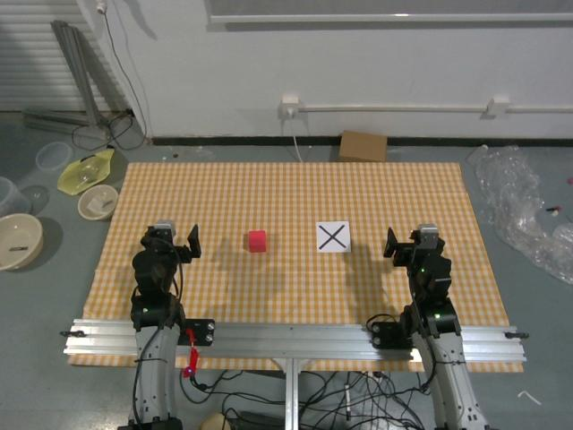
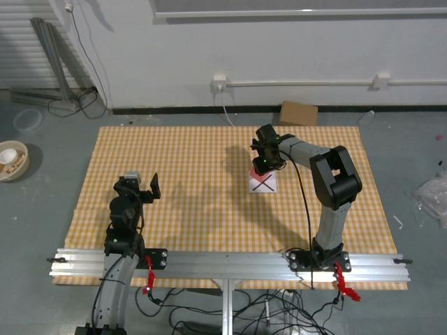
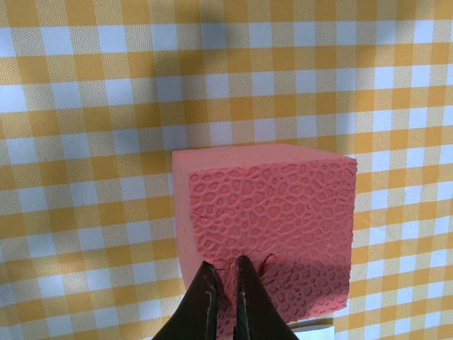
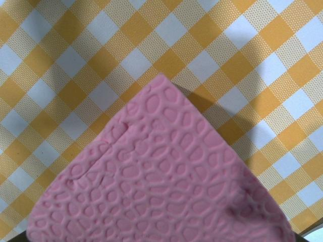
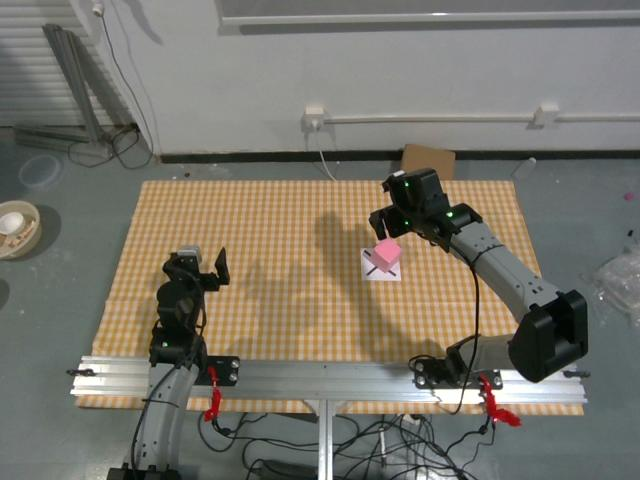
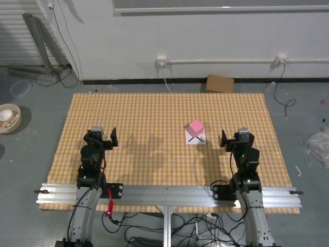

# YAM3 Astra pick-and-place: Trials 1–15

## Summary

YAM3 progressed from isolated, barely visible joint probes to complete right-arm pick-and-place episodes, first in Trial 13 and again in Trial 15. Coupled moves and sign priors improved approach; grasp depth, release timing, and contact recovery determined completion. Trial 15 combined wrist-relative depth checks with contact recovery guidance and completed placement plus return to rest in 20 calls, versus Trial 13’s 29.

## Attempts table (Runs 001–015)

Caps are **arm radians / normalized gripper delta per call**, not interpolation increments. Runtime is manifest `ended_time_ns − started_time_ns`, rounded to 0.01 s, including waits/cleanup. Calls count HTTP attempts, including failures. Early prompt labels below describe revisions; only V2–V4 were explicitly versioned. “Success” follows supervisor observation, final imagery, and model `done`; every saved result still says `physical_success: unverified`.

| Trial | Prompt revision | Caps | Calls | Runtime (s) | Outcome / principal observation |
|---|---|---:|---:|---:|---|
| 001 | Initial probes | .05 / .10 | 3 | 48.34 | Gave up; +.02 J0 probe, then hold. |
| 002 | Six-probe policy | .05 / .10 | 8 | 147.36 | Gave up; image direction/depth unresolved. |
| 003 | Larger probes | .15 / .10 | 5 | 94.15 | Gave up after delta-clamp intervention. |
| 004 | Checkpoint policy | .15 / .10 | 2 | 42.68 | Targets not identified; no task motion. |
| 005 | Same as 004 | .15 / .10 | 7 | 138.61 | Geometry/checkpoint uncertainty stopped approach. |
| 006 | Progress-driven exploration | .15 / .10 | 14 | 407.05 | Gave up before closure; reach/depth unresolved. |
| 007 | Stronger exploration | .15 / .10 | 41 | 1274.11 | Long probing sequence; requested unavailable view. |
| 008 | Attended approach | .15 (.45*) / .10 | 23 | 1214.97 | Approach improved; crossing clearance unresolved. |
| 009 | Cartesian-goal policy | .15 (.45*) / .10† | 1 | 17.05 | Registration/TCP/checker prerequisites absent. |
| 010 | Conditional joint fallback | .15 (.45*) / .10† | 27 | 1417.27 | API timeout; no completed placement. |
| 011 | Sign priors + scene hints | .45 / .50 | 27 | 1011.90 | Placement contact/stall; daemon FAULT ended run. |
| 012 | V2 | .45 / 1.00 | 22 | 1046.70 | Tilted wrist, empty closes; contact-triggered give-up. |
| 013 | V3 | .45 / 1.00 | 29 | 937.61 | **First success**; released and withdrew. |
| 014 | V4 | .80 / 1.00 | 13 | 418.17 | Two empty closes; tipped block; model gave up. |
| 015 | V4 + depth/recovery revision | .80 / 1.00 | 20 | 605.83 | **Second success**; X placement and return to rest. |

\* .45 required an exact verified approach; other moves retained .15. † Cartesian goals had separate prerequisite-gated planning, not these displacement caps. Trial 10 excludes its separate resume.

Sources: per-run manifests, saved prompts, wire requests and journals; cross-checked against `.bak` snapshots and [offline reviews](offline-review/). Audits confirm Trial 3’s [planner/guard mismatch](offline-review/run-003-transition.json) and Trial 10’s [26 requests plus timeout](offline-review/run-010-resume/assessment.json). Trial 11 did not confirm final hold; the other original attempts did.

## What we changed & why

- **Trials 1–7: Make exploration useful.** The first prompts asked Astra to learn joint directions through small, mostly single-joint probes. These movements often produced too little visible change for Astra to understand how to approach the block. We raised the arm’s per-call limit from 0.05 to 0.15 rad and revised the wording to encourage purposeful movement when clearance was visible. Separately, we repaired the planner/guard reference mismatch exposed in Trial 3; that was a control-code correction, not a prompt improvement.

- **Trials 8–10: Clarify which controls were actually available.** We introduced an optional, verified approach path that could use up to 0.45 rad per joint, while ordinary moves remained limited to 0.15 rad. We also explored Cartesian pose commands, but the station lacked the camera registration, calibrated fingertip reference, and path checker needed to use them. The prompt was revised to allow bounded joint-space exploration rather than treating those missing Cartesian prerequisites as a reason to stop all progress.

- **Trial 11: Explain the arm’s geometry and combine movements.** We added joint-direction priors: how base yaw sweeps the arm, how shoulder and elbow work together to extend or lift, and how wrist pitch points the fingers downward. We encouraged simultaneous joint changes and raised the general arm limit to 0.45 rad. This accelerated the approach, but the prompt also included scene-specific joint angles, and its placement instructions did not sufficiently discourage pressing the held block into the table.

- **Trial 12, V2: Generalize the approach and release earlier.** We removed scene-specific pose values and waypoint hints while retaining hardware-direction priors. We added measured-versus-commanded joint checks as contact cues and instructed Astra to release near the paper surface instead of continuing downward. Full gripper opening or closure became possible in one call. However, the prompt encouraged wrist-roll alignment, which tilted the jaws, and visual overlap in `main` still led to empty grasps.

- **Trial 13, V3: Keep the jaws level and improve grasp recovery.** We instructed Astra to keep wrist roll near its initial neutral orientation and close only when the pads appeared to straddle the block’s lower half. After an empty closure, it should reopen and make a decisive, observed descent; if reopening shifted the block, it should lift and re-center. These changes preceded the first completed pick-and-place episode.

- **Trial 14, V4: Improve transit and define a fuller finish.** We raised the arm limit to 0.80 rad, required placement directly over the black X, and added a return to the initial resting pose before `done`. We replaced the block-specific gripper stall range with a more general nonempty-closure criterion plus lift verification. Nevertheless, Astra closed above the block twice and interpreted subsequent contact as a reason to abandon the task.

- **Trial 15: Prioritize wrist depth and distinguish contact from failure.** We made the wrist camera’s pad-to-block geometry the primary grasp-depth cue, with `main` used to cross-check clearance. An empty closure now required reassessing both depth and alignment. We also aligned the prompt and tool descriptions: contact should stop further descent, followed by a clear, guard-permitted withdrawal and reassessment when feasible, rather than an immediate `give_up`. Trial 15 completed placement and return-to-rest. The actual 0.08 rad tracking guard remained unchanged.

| Early exploration / placement contact | Wrist failure / grasp evidence |
|---|---|
|  |  |
|  |  |
|  |  |

JPEG provenance: [source hashes](report_assets/frame_sources.json). Stalls and empty closures are established by logs, not stills.

## Key know-how

- Hardware sign priors generalize better than memorized scene waypoints.
- Coupled transit reduces decisions; fine steps belong near grasp/contact.
- Overhead overlap cannot establish depth; wrist scale also needs pad-relative geometry.
- Empty closure requires reassessing height **and** fore-aft/lateral alignment.
- Stop advancing on contact; assess a clear, guard-permitted retreat before abandoning recovery.
