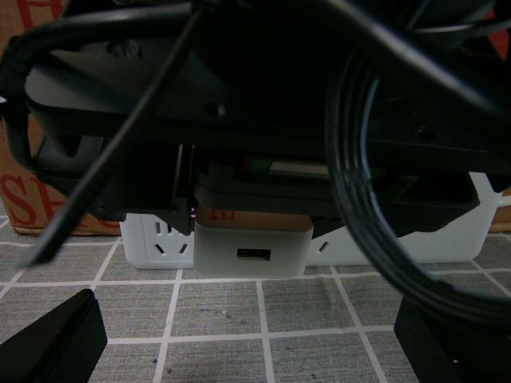
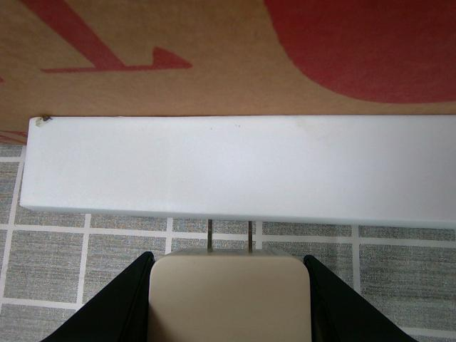
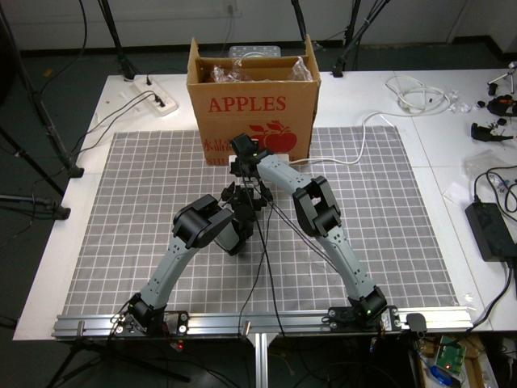

# Left camera right behind the charging block

Captured 2026-11-22T06:05:07.773133+08:00. This is the updated rear-view reference.
The daemon mode was `GRAVITY` at the first reading and `GRAVITY` at the last.

Trial 10 pose checks passed for this snapshot. `left_j3` was 89.56°. The closest modeled separation was 9.80 cm against a 7.35 cm threshold. The separation check covers the captured pose.

The charger’s rear USB-A port is visible in the left wrist shot.

## Joint positions

| Joint | Left (rad) | Right (rad) |
| --- | ---: | ---: |
| J0 | -0.695621 | 0.574311 |
| J1 | 2.514115 | 2.559510 |
| J2 | 1.059167 | 2.237163 |
| J3 | 1.563096 | -0.533875 |
| J4 | -0.665484 | 0.269131 |
| J5 | -0.034142 | 0.523575 |
| Gripper opening (0–1) | 0.999207 | 0.515798 |

Joint variation during capture was at most 0.022° left and 0.000° right. JPEG responses arrived within 1.9 ms. This is measured at receipt. [Raw joint feedback and timestamps](pose.json).

## Left wrist camera

## Right wrist camera

## Main camera

